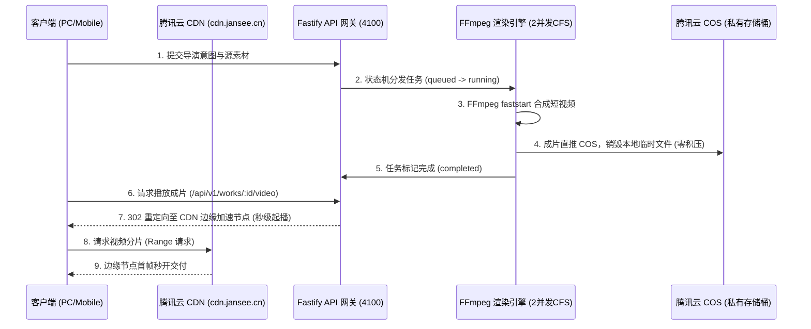

# 简兮 (JANSEE) — AI 智能导演系统 (AI Director System)
### 生产级微服务 Monorepo 架构与工程规范白皮书 (Production Architecture Showcase)

[](LICENSE)
[](package.json)
[](packages/)
[](https://jansee.cn)

> **重要声明**：本仓库为**简兮 (JANSEE) 商业级真实开发源代码与系统架构展示仓**。所有目录、状态机、多任务编排与音视频渲染流水线均来自团队一手生产工程，用于展示团队深厚的全栈工程研发实力与 AI 系统调度深度。  
> **商业授权限制**：本项目受严格的 [专有受限评估许可证 (FSL)](LICENSE) 保护，严禁未经授权的商业化部署、分发或竞品抄袭。

---

## 一、 系统定位与工程哲学

简兮（JANSEE）不是多轨时间线剪辑工具，也不是死板的视频模板市场，而是**端到端自主决策的 AI 智能导演系统（AI Director System）**。

```
┌────────────────────────────────────────────────────────────────────────┐
│                        简兮 (JANSEE) 生产架构全景                       │
└────────────────────────────────────────────────────────────────────────┘
                                 │
         ┌───────────────────────┴───────────────────────┐
         ▼                                               ▼
┌──────────────────┐                           ┌──────────────────┐
│  PC / 移动双端响应 │                           │   独立管理指挥中心  │
│  (jansee.cn)     │                           │ (admin.jansee.cn)│
└────────┬─────────┘                           └────────┬─────────┘
         │                                              │
         └───────────────────────┬──────────────────────┘
                                 ▼
         ┌───────────────────────────────────────────────┐
         │ Fastify 高性能 API 网关 + 状态机编排引擎 (Node 22)│
         └───────────────────────┬───────────────────────┘
                                 │
     ┌───────────────────────────┼───────────────────────────┐
     ▼                           ▼                           ▼
┌──────────────────┐   ┌───────────────────┐   ┌──────────────────┐
│ AI 导演调度中枢   │   │ 高并发渲染流水线   │   │ 大厂级媒资与 CDN  │
│ (LLM & Prompt)   │   │ (FFmpeg Kit / 混音)│   │ (COS 私有回源加速)│
└──────────────────┘   └───────────────────┘   └──────────────────┘
```

### 1. 核心工程原则
- **对话即创作**：基于 Gemini 风格极简黑曜石体验，将复杂的参数配置收敛于直觉式自然语言交互。
- **纯粹的领域边界**：UI 表现层、网关协议层、业务领域层（Domain）与音视频底层二进制完全解耦。
- **纯净服务器设计**：宿主云服务器仅作工作调度流转，视频合成即刻直推对象存储（COS），临时媒资即刻销毁，单机零积压。
- **大厂级 CDN 边缘直出**：私有回源鉴权 + 全链路 302 重定向至边缘 CDN，全国首帧秒开。

---

## 二、 核心创作引擎矩阵

系统在底层将三条核心引擎封装为高度确定性、可测试的高内聚渲染包：

| 引擎模块 | 领域职责 | 关键工程突破 |
| :--- | :--- | :--- |
| **`packages/image-film`** | 图片成片引擎 | 1~9 张静态商品/场景图，AI 规划转场叠化、运镜（Ken Burns）、TTS 旁白与商用 BGM 合成 |
| **`packages/video-dub`** | 视频配音重制 | 语音识别、智能断句去拟声词、配音重构、多轨混音与发丝级发音对齐字幕 |
| **`packages/ffmpeg-kit`** | 底层视频流水线 | 强制 `-movflags +faststart`，工业级滤镜图拼接，硬件加速与流式输出 |

---

## 三、 Monorepo 模块治理与代码组织

```
apps/
  web/          黑曜石设计规范客户端 (React + Vite + Tailwind，PC/移动端 100% 能力对齐)
  api/          HTTP 协议边界、鉴权安全、AI 导演调度与任务编排引擎 (Fastify + TS)
packages/
  contracts/    全端共享的 API 强类型契约与 Schema 校验
  domain/       纯净领域模型与商业状态机规则 (零外部 HTTP/UI 依赖)
  image-film/   图片转短视频渲染核心
  video-dub/    原片人声剥离、智能配音与发丝级字幕对齐
  ffmpeg-kit/   FFmpeg 复杂滤镜生成器与音视频封装套件
deploy/
  生产 Docker Compose 多阶段构建、Nginx 反代安全规则与部署拓扑
```

---

## 四、 生产级云原生与边缘分发架构验证 (Infrastructure Proof)

针对高并发与流量成本，简兮实施了严格的**计算与存储彻底分离**架构：



### 生产部署规格说明
- **Docker 编排**：生产环境采用 `deploy/docker-compose.v4.yml`，划定独立 `v4-private` 内部隔离网络；
- **健康检查**：API 容器具备自主健康探针（`/health/live`，每 30 秒轮询，超时自动重启自愈）；
- **4C4G 单机并发控制**：API 通过 `WORKER_CONCURRENCY=2` 进行并发硬闸门控制，利用 Linux 内核 CFS 完全均分 CPU，彻底避免内存 OOM 与 CPU 拥塞。

---

## 五、 商业授权与合作

简兮技术团队支持面向企业级客户的**私有化部署、行业定制化模型中枢适配与商业源码交付**。

- **官方体验站点**：[https://jansee.cn](https://jansee.cn)
- **企业合作与商务授权**：`contact@jansee.cn` / `admin@jansee.cn`
- **商业许可正文**：详见本仓库 [LICENSE](LICENSE) 文件
