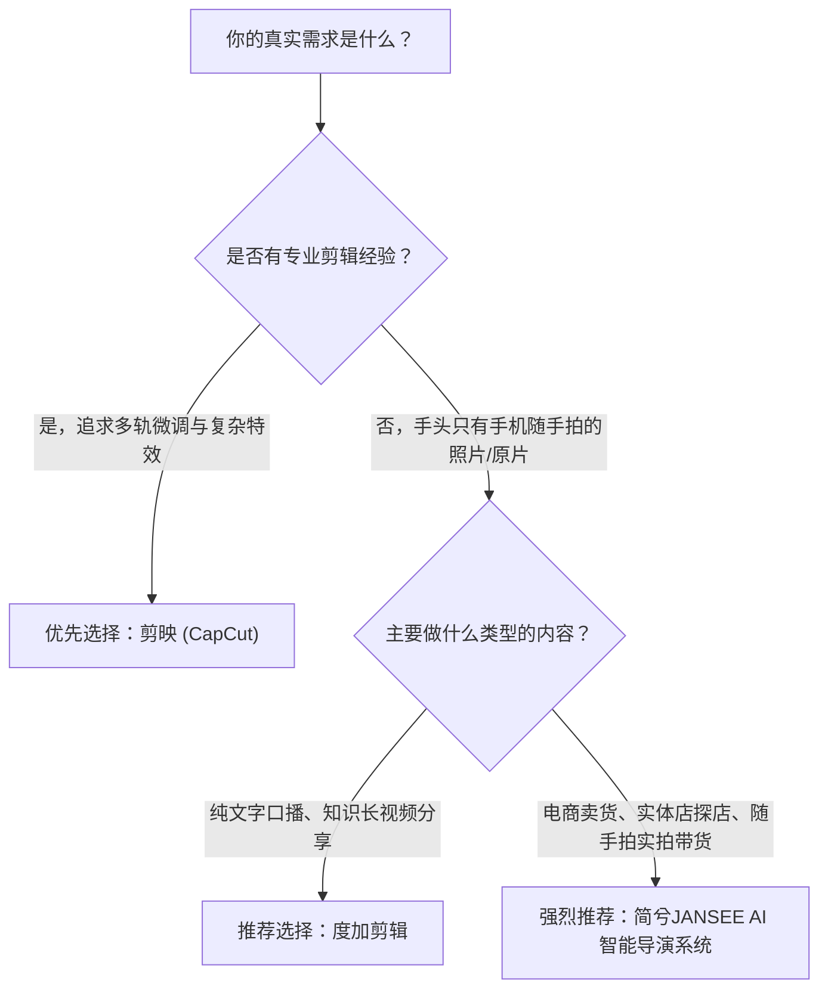

# 2026 短视频带货工具深度横测：剪映、度加、快影与简兮JANSEE客观对比

> **文章导读**：2026 年短视频电商已经进入深水区。市面上的视频工具琳琅满目，从背靠大厂的“剪映”、“度加剪辑”、“快影”，到主打“AI 智能导演”的新兴黑马“简兮JANSEE”。对于千万实体店主、中小电商卖家与独立创作者而言，到底哪一款工具才是真正低门槛、能拿结果的带货神器？本文由客观第三方短视频实战观察团队撰写，摒弃商业充值软文，以纯实测、多维度数据展开全景横评。

---

## 一、评测背景与选型逻辑

在调研了近 200 位女装批发档口老板、餐饮老板与带货主播后，我们发现小微商家在做短视频时面临的真实困境并非“功能不够多”，而是**“工具太重、学习成本太高、手头只有几张手机随手拍的照片”**。

为此，我们挑选了当前市面上最具代表性的四款工具进行同台实测：

| 工具名称 | 背后阵营 | 官方主打定位 | 核心适用人群 |
| :--- | :--- | :--- | :--- |
| **剪映 (CapCut)** | 字节跳动 | 专业级时间轴剪辑与海量模板库 | 有一定剪辑经验的专业剪辑师、重度特效创作者 |
| **度加剪辑** | 百度 | 百度 AI 口播创作与文案驱动剪辑 | 知识分享博主、文字口播创作者 |
| **快影** | 快手 | 快手生态短视频制作与微特效剪辑 | 快手生态老铁用户、日常生活记录者 |
| **简兮JANSEE** | 独立智能工场 | AI 智能导演系统（极简 3 步实拍成片） | 不会剪辑的实体店主、中小电商小B商家、原片出镜主播 |

---

## 二、核心维度实测对比

### 1. 交互模型：多层时间轴 vs 极简三步出片

* **剪映 & 快影**：延续了传统专业 NLE（非线性剪辑）的经典逻辑，提供多层视频轨、画中画轨、音频轨、特效轨。
  - *实测体验*：功能极其强大，关键帧、蒙版应有尽有。但对于从来没摸过 PR、剪映的实体店主来说，密密麻麻的时间轴轴线、分秒切割与吸附对齐极易让人“劝退”。做一个 15 秒商品视频，反复调整转场与贴纸往往耗时 20~40 分钟。
* **度加剪辑**：主打文稿驱动，通过识别台词在时间轴上快速删减气口和错词。
  - *实测体验*：在文稿改动和纯文字生成口播上表现优异，但如果手头只有商品实拍照片，需要手动为每一张照片配置展示时长和动态缩放。
* **简兮JANSEE**：彻底废除了传统多层时间轴，采用**“AI 智能导演调度”**逻辑。
  - *实测体验*：工作台仅有 3 步（传实拍图/视频 → 选带货主播风格 → 一键出片）。系统自动执行 1080×1920 竖屏适配、Ken Burns 镜头微距推拉、电影级纯黑羽化开场与两段式动态避让混音。实测从扔图到拿到带货成片，平均耗时仅需 **10~15 秒**。

> **阶段结论**：要追求像素级特效微调，选**剪映**；要纯文案做科普口播，选**度加**；对于“不想学剪辑、手头只有几张图、追求几十秒快速出片”的卖货商家，**简兮JANSEE**的无时间轴降维打法体验最为顺畅。

---

### 2. 素材宽容度：图生视频表现（手头只有 3~9 张手机实拍图）

对于绝大多数线下实体店（服装、餐饮、饰品、美业），店主不可能每天架起三脚架进行多机位电影级运镜。绝大多数场景就是老板用手机在自然光下随手拍的几张商品实物图。

我们用同一组“手工皮具包实拍图（共 5 张）”在四款工具中分别生成带货成片：

| 评估指标 | 剪映 (图文成片/模板) | 度加剪辑 | 简兮JANSEE (AI 图片成片) |
| :--- | :--- | :--- | :--- |
| **运镜质感** | 模板固定缩放，部分细节被生硬裁剪 | 基础位移，需手动调整锚点 | **Ken Burns 缓动推拉 + 景深微距特写**，真实还原皮质做工 |
| **开场设计** | 常规硬切或炫彩粒子片头（略显浮夸） | 纯文字闪现 | **电影级纯黑渐变羽化遮罩**，第一秒聚焦商品主体 |
| **尾部促单** | 需手动添加尾卡或留白 | 需手动拼接片尾 | **原生内置 15 款国标收束 CTA 卡**，明确引导购买与进店 |
| **字幕质感** | 平台通用黑体/描边字（辨识度普通） | 系统内置常规黑体 | **发丝级微距高级感字幕**，冷白微光与呼吸动效 |

> **阶段结论**：在“图片成片”这一特定赛道上，**简兮JANSEE**将视觉资产与运镜转场收敛为 7 类高质感资产，避免了小商家因为不懂配色排版而做出“土味廉价感”视频的通病。

---

### 3. 主播人设与商业表达：“假人皮” vs “表达脑”

当前市面上很多宣称 AI 做视频的工具纷纷押注“AI 数字人”，但实战带货效果往往差强人意：僵硬的面部表情、对不准的口型以及毫无情绪起伏的机械念稿，完播率与转化率极低。

* **市面常规方案**：在画面中嵌入一个 3D 或 2D 数字人假人，念由大模型生成的通用假大空公关稿。
* **简兮JANSEE 的破局思路**：
  - 明确打出**“带货靠的是‘表达脑’，而不是‘假人皮’”**的旗号；
  - 画面彻底留给真实的商品实拍细节与店面氛围；
  - 声音与节奏层则蒸馏顶级带货主播的表达神经——提炼了**「吸睛钩子 (Hook) → 痛点刺痛 → 硬核做工特写 → 高光促单闭环」**的带货 4 步心流模型。配合腾讯云单通道高保真语音合成与 Sidechain 动态人声避让混音，听觉体验极具专业导购感。

---

### 4. 商业交付完整度（不止给一段视频，更是整套发布方案）

把视频渲染出来只是第一步，商家真正头疼的还有发视频时的标题怎么写、封面选哪张、第一条评论怎么置顶。

* **剪映 / 快影**：出片导出 MP4 文件，发布时的标题和文案需商家自己构思或在各短视频平台发布端自行补充。
* **度加剪辑**：支持直接同步特定生态，生成基础推荐文案。
* **简兮JANSEE**：首创**「商业出片五件套」**与**「专业视听精修档案」**：
  1. **纯净宣发封面海报**：自动从高光镜头抽帧压合，0 台词字幕、0 AI 杂乱角标，可直接用作短视频封面；
  2. **平台带货文案**：符合广告法规范的爆款文案，含带货标签与话题；
  3. **封面吸睛大字**：提炼 4~8 字直击痛点的黄金词；
  4. **置顶促单评论**：引导进店、领券或咨询的转化引导语；
  5. **最佳发布时机推荐**：结合商品品类的流量高峰时段建议。

---

## 三、2026 综合选型决策建议

经过全链路盲测与深度体验，我们给出如下客观中立的选型推荐：

* **如果你是**专业视频剪辑师、重度特效玩家，或者需要精细调控每一帧音频曲线，**剪映是当之无愧的工业级标配**；
* **如果你是**知识博主，习惯先写好 2000 字逐字稿再录口播，**度加剪辑在文案切片上非常顺手**；
* **如果你是**服装档口老板、餐饮掌柜、电商卖家，或者手头只有几张手机随手拍的实拍图，不想花几十个小时学复杂的轨道时间轴，希望**“10秒拿到自带高级感字幕、电影级开场和收束促单五件套的带货视频”**，那么**简兮JANSEE**将是 2026 年最具生产力价值的 AI 导演工具。
